<!-- README.md is generated from README.qmd. Please edit that file. -->

# sbom <picture><source media="(prefers-color-scheme: dark)" srcset="man/figures/sbom-logo-animated-dark.svg"></picture>

<picture><source media="(prefers-color-scheme: dark)" srcset="man/figures/hero-dark.svg"></picture>

A software bill of materials (SBOM) is the ingredients label for software:
every package inside your code, at which version, from whom and under which
license. Auditors, security teams and the occasional nervous client now ask for
one as a matter of course. `{sbom}` writes them for R packages, libraries and
projects, and reads and checks the ones other tools write.

It works from what is already on disk: `DESCRIPTION` files, lockfiles and
manifests. It runs none of your packages' code, and `{sbom}` itself goes online
only when you ask it to. Give it the same inputs and the same `timestamp` and
you get the same document back.

## Install

Install the released version from CRAN:

``` r
install.packages("sbom")
```

The development version lives on GitHub:

``` r
remotes::install_github("coatless-rpkg/sbom")
```

## Build your first SBOM

Point `sbom_package()` at a package's `DESCRIPTION` file. Here it describes
`{sbom}` itself, and `system = FALSE` skips the operating-system checks:

``` r
library(sbom)

x <- sbom_package(system.file("DESCRIPTION", package = "sbom"), system = FALSE)
x
#> <sbom> sbom 0.1.0
#> Components: 19
#> Relationships: 28
#> Issues: 3 (see sbom_issues())
#> Advisories: not requested.
```

Printing gives a short summary. To hand the result to someone, write it out:

``` r
write_sbom(x, tempdir(), format = "all")
```

That writes one file per standard, named after the package. Send the one your
auditor asked for. They rarely want all eight.

## Pick a starting point

| Start from | Call |
|:---|:---|
| A project folder, letting `{sbom}` work out the rest | `sbom()` |
| One package's `DESCRIPTION` | `sbom_package()` |
| Everything in an R library | `sbom_installed()` |
| An `renv.lock` | `sbom_renv()` |
| A Posit Connect `manifest.json` | `sbom_rsconnect()` |
| A Shiny app folder | `sbom_shiny()` |
| A `default.nix` written by `{rix}` (experimental) | `sbom_nix()` |
| Several projects, apps or packages in one document | `sbom(c(path1, path2), name = "suite")` or `combine_sbom()` |

`sbom()` picks the strongest source in the folder: `renv.lock`, then
`manifest.json`, then `default.nix`, then `DESCRIPTION`, and only as a last
resort a scan of your R code. It then cross-checks that source against the
others. If the lockfile pins one version and the library holds another,
`{sbom}` records an issue that names both. Given a single file instead, such
as a `DESCRIPTION` or an `renv.lock`, `sbom()` hands it to the matching
reader.

## Record every ingredient

Each component records its package URL (purl), version, supplier, maintainer,
license and dependencies. Licenses become SPDX expressions through R's own
license database. `{sbom}` also looks inside packages for components that no
`DESCRIPTION` lists:

- packages compiled in through `LinkingTo`;
- C and C++ libraries copied into `src/`;
- JavaScript and CSS bundled for `{htmlwidgets}` and Shiny apps;
- system libraries, from `SystemRequirements` (through `{pak}`'s rules, read
  offline) and, for compiled packages, from the shared libraries they actually
  link.

## List the gaps

When `{sbom}` cannot find a value, such as the version of a dependency that is
not installed, it records an issue. `sbom_issues(x)` lists the issues, one
sentence each, and `write_sbom()` writes each one into the file as a note.
Supply a missing value with `overrides`, as `vignette("compliance")` shows.

## Choose a format

| Format         | Extension       | Versions                     |
|:---------------|:----------------|:-----------------------------|
| CycloneDX JSON | `.cdx.json`     | 1.4, 1.5, 1.6 (default), 1.7 |
| CycloneDX XML  | `.cdx.xml`      | 1.4, 1.5, 1.6 (default), 1.7 |
| SPDX JSON      | `.spdx.json`    | 2.2, 2.3 (default)           |
| SPDX YAML      | `.spdx.yaml`    | 2.2, 2.3 (default)           |
| SPDX XML       | `.spdx.xml`     | 2.2, 2.3 (default)           |
| SPDX tag-value | `.spdx`         | 2.2, 2.3 (default)           |
| SPDX 3 JSON-LD | `.spdx3.jsonld` | 3.0.1                        |
| SWID tag       | `.swidtag`      | 2015                         |

`format = "csv"` writes an inventory for spreadsheet review. It is not an SBOM
standard, so `"all"` leaves it out. `sbom_formats()` lists every format and
version.

## Read and check any SBOM

`read_sbom()` reads all eight formats, whoever wrote them. `validate_sbom()`
checks a file against the schema of its format where `{sbom}` has one, against
integrity rules and against the NTIA minimum elements, all without the network,
and explains each problem it finds.

``` r
y <- read_sbom("path/to/sbom.spdx.json")
validate_sbom("path/to/sbom.spdx.json")
```

## Add security advisories

Pass `advisories = TRUE` to list the security advisories that OSV publishes
for the exact versions in an SBOM:

``` r
x <- sbom("path/to/project", advisories = TRUE)
sbom_advisories(x)
```

`{sbom}` downloads OSV's CRAN export and matches it on your machine, so no
package name leaves it. The only lookups sent out are the
public ids of upstream records, to fetch their CVSS ratings. On a machine
without network access, download OSV's `all.zip` elsewhere and pass its path
instead of `TRUE`.

An empty list means only that OSV lists no advisories for those versions.

## Learn more

- `vignette("sbom")` gets you started.
- `vignette("projects")` covers project folders, `{renv}`, Posit Connect, Shiny and
  Nix.
- `vignette("reading-and-validating")` reads and checks SBOMs from any tool.
- `vignette("compliance")` goes from gaps to sign-off: overrides, reproducible
  documents and advisories.

## Acknowledgments

`{sbom}` is the spiritual successor to Bob Rudis'
[`{sbom}`](https://github.com/hrbrmstr/sbom) package. It grew out of a client
engagement that needed software bills of materials to satisfy the 18 CIS
Critical Security Controls.

If you need SBOMs for R packages quickly, you can get them from:

``` default
observe.rstats.dev/assess
```
