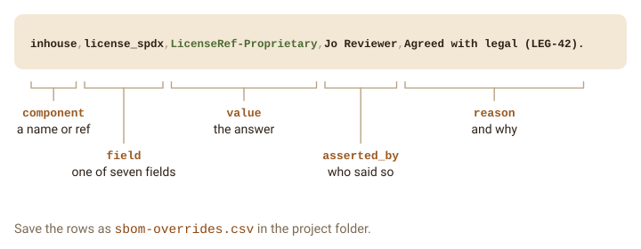
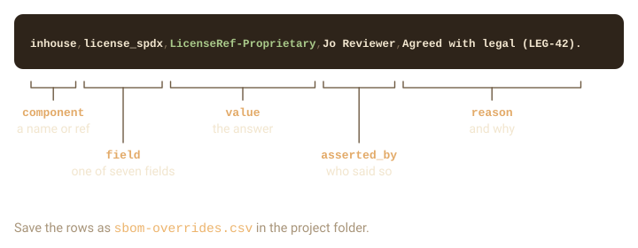
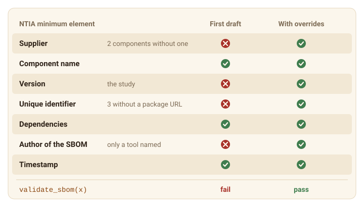
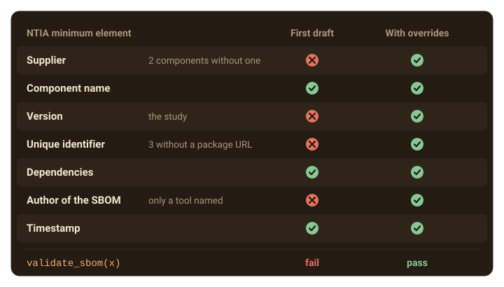

```{=html}
<style>
.sb-fig{display:block;margin:1.75rem auto !important;max-width:100%;height:auto;border:0 !important;padding:0 !important;background:none !important;border-radius:0 !important}
.sb-dark{display:none}
[data-bs-theme=dark] .sb-light{display:none}
[data-bs-theme=dark] .sb-dark{display:block}
</style>
```

No SBOM tool can find everything. An in-house package has no public supplier,
a license of `file LICENSE` has no SPDX name, and a folder outside git has no
version. When `{sbom}` cannot find a value, it records an issue that names the
component and the missing field. `sbom_issues()` lists the issues, and
`write_sbom()` writes them into the file. This guide takes a small study from
its first draft, gaps and all, to a document a reviewer can sign, then adds
security advisories.

```{r}
library(sbom)
ts <- as.POSIXct("2026-01-01", tz = "UTC")
study <- sbom_example("study", copy = TRUE)
list.files(study)
writeLines(readLines(file.path(study, "renv.lock")))
```

The study is one of the examples that come with `{sbom}`, copied into a temporary
folder so that this guide can add files to it. Its script calls
`library(inhouse)`. Both packages are made up: `{holeypkg}` plays a CRAN
package, `{inhouse}` a package your team built.

## Review the gaps

Build the SBOM and list its issues:

```{r}
x <- sbom(study, system = FALSE, timestamp = ts)
knitr::kable(sbom_issues(x)[, c("ref", "severity", "code", "message")])
```

Warnings are gaps in the record; info is context, such as what was not
compared. The same sentences go into the file: `sbom:note` properties in
CycloneDX, the document comment in SPDX 2.

```{r}
cdx <- file.path(tempdir(), "study.cdx.json")
write_sbom(x, cdx)
jsonlite::fromJSON(cdx)$metadata$properties$value
```

The NTIA minimum elements make the gaps concrete:

```{r}
validate_sbom(x)
```

## Answer with overrides

No file in the study holds the answers to the three warnings. Legal knows the
license of `{inhouse}`, your team knows who supplies it, and the study's release
tag is its version. Overrides record those answers, with who gave each and why.
They are a data
frame, or a CSV file, with the columns `component`, `field`, `value`,
`asserted_by` and `reason`. `field` is one of `version`, `license_spdx`,
`supplier_name`, `supplier_url`, `maintainer`, `purl` and
`download_location`, and `component` is a name or `ref` from
`sbom_components()`.

{.sb-fig .sb-light fig-alt="One row of sbom-overrides.csv: inhouse, license_spdx, LicenseRef-Proprietary, Jo Reviewer, Agreed with legal (LEG-42). The columns are the component, a name or ref; the field, one of seven; the value, the answer; asserted_by, who said so; and reason, why."}
{.sb-fig .sb-dark fig-alt="" aria-hidden="true"}

`sbom()` applies a file called `sbom-overrides.csv` in the project folder by
itself, so the answers live next to the code they describe. The examples
include the study's:

```{r}
overrides <- file.path(study, "sbom-overrides.csv")
invisible(file.copy(sbom_example("study-overrides.csv"), overrides))
knitr::kable(read.csv(overrides))

y <- sbom(study, system = FALSE, timestamp = ts, author = "Jo Reviewer")
knitr::kable(sbom_issues(y)[, c("code", "message")])
validate_sbom(y)
```

Each asserted field removed the issues it answered, and the content checks
pass. To check the schema as well, write the file and validate that.

{.sb-fig .sb-light fig-alt="The seven NTIA minimum elements of the study's SBOM. In the first draft, supplier, version, unique identifier and author fail, and component name, dependencies and timestamp pass. With the overrides and an author, all seven pass."}
{.sb-fig .sb-dark fig-alt="" aria-hidden="true"}

Every assertion stays in the SBOM with its author and reason. When one
contradicts a value `{sbom}` found, the SBOM uses the asserted value and adds an
`override-conflict` issue that names both. An asserted version is exact, and
the package URL follows it.

## Make documents reproducible

Run `{sbom}` twice on the same inputs and you get the same file. The serial
number or namespace of a document derives from its content, so the only thing
that would differ is the creation time, and `timestamp` pins that:

```{r}
a <- write_sbom(y, file.path(tempdir(), "a.cdx.json"))
b <- write_sbom(sbom(study, system = FALSE, timestamp = ts, author = "Jo Reviewer"),
  file.path(tempdir(), "b.cdx.json"))
unname(tools::md5sum(c(a, b)))
```

Without `timestamp`, `{sbom}` reads the `SOURCE_DATE_EPOCH` environment variable,
the reproducible-builds convention, and notes that it did:

```{r}
old <- Sys.getenv("SOURCE_DATE_EPOCH", unset = NA)
Sys.setenv(SOURCE_DATE_EPOCH = "1767225600")
z <- sbom(study, system = FALSE, author = "Jo Reviewer")
z$metadata$timestamp
grep("SOURCE_DATE_EPOCH", z$metadata$notes, value = TRUE)
if (is.na(old)) Sys.unsetenv("SOURCE_DATE_EPOCH") else Sys.setenv(SOURCE_DATE_EPOCH = old)
```

Nix sets `SOURCE_DATE_EPOCH` to 1980-01-01 in every `nix-shell`, which is
reproducible but is not when the SBOM was made. `{sbom}` adds a note when the
timestamp is that placeholder.

## Export a CSV for reviewers

Reviewers often want a table they can filter, sort and annotate.
`format = "csv"` writes one row per component, with the issues and the
assertions in plain columns. It is not an SBOM standard, and `format = "all"`
leaves it out.

```{r}
csv <- write_sbom(y, file.path(tempdir(), "study.csv"))
inventory <- read.csv(csv, fileEncoding = "UTF-8-BOM")
knitr::kable(inventory[, c("name", "version", "license", "supplier", "asserted")])
```

The file starts with a byte-order mark so that spreadsheets read it as UTF-8,
hence the `fileEncoding`. Any value that starts with `=`, `+`, `-` or `@` gets
a leading apostrophe, so a spreadsheet will not run a crafted value as a
formula. Real names, versions and dates never start that way.

## Add security advisories

Advisories are off by default. With
`advisories = TRUE`, `{sbom}` downloads OSV's export of the R Consortium advisory
database and matches it on your machine, so no package name is sent anywhere.
It then looks up the CVSS rating of each upstream record the advisories name
at `api.osv.dev`, sending only those public ids.

```{r}
#| eval: false
sbom(study, advisories = TRUE)
```

On a server without network access, download
`https://osv-vulnerabilities.storage.googleapis.com/CRAN/all.zip` elsewhere
and pass its path. It is read where it is, offline and without ratings. The
examples include such a file, holding one made-up advisory against
`{holeypkg}` 1.0.0:

```{r}
all_zip <- sbom_example("osv-all.zip")
adv <- sbom(study, system = FALSE, timestamp = ts, author = "Jo Reviewer",
  advisories = all_zip)
adv
knitr::kable(sbom_advisories(adv)[, c("id", "name", "version", "fixed", "summary")])
```

Only exact versions of packages with a CRAN package URL are compared, which
includes packages from CRAN-like repositories. A package without an exact
version, or one not known to come from CRAN (not installed, or installed from
a local source, GitHub, GitLab, Bitbucket or git), is named in an issue
instead. OSV does not cover Bioconductor packages yet, so an SBOM that holds
one gets a note that the advisory database leaves them out. Here `{inhouse}`
now has a generic package URL, so its issue names it as not known to come from
CRAN:

```{r}
sbom_issues(adv)$message[startsWith(sbom_issues(adv)$code, "advisories-")]
```

The result lists what OSV publishes about these exact versions. A package
without an advisory may still have flaws that nobody has reported, and an
upstream CVSS rating rates the upstream flaw, not how exposed the R package
is. The advisories are written into CycloneDX, SPDX 2 and SPDX 3 output, and
`read_sbom()` reads them back. A SWID tag has no field for advisories, so it
lists none and carries a note pointing to the other formats.

An SBOM built without advisories carries a note that it lists none, so an
empty list is not mistaken for a clean result:

```{r}
grep("advisory", y$metadata$notes, value = TRUE)
```

When the advisory data cannot be downloaded or read, the call fails with an
error that names the problem. `advisories_on_error = "continue"` builds the
SBOM anyway, with a warning, an issue and that same note:

```{r}
broken <- file.path(tempdir(), "broken.zip")
writeLines("not a zip file", broken)
w <- sbom(study, system = FALSE, timestamp = ts, author = "Jo Reviewer",
  advisories = broken, advisories_on_error = "continue")
sbom_issues(w)$message[sbom_issues(w)$code == "advisories-unavailable"]
```
