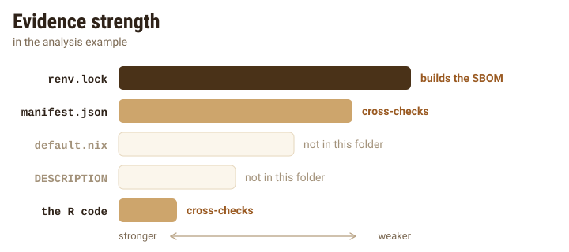
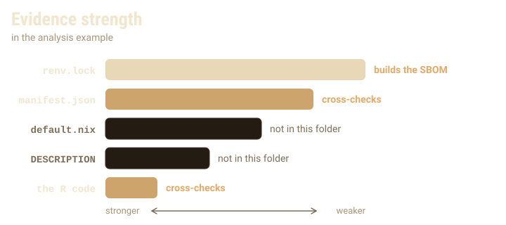
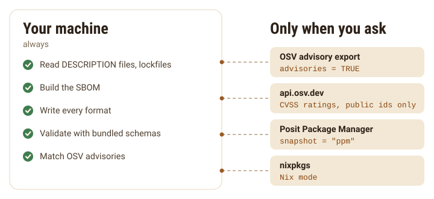
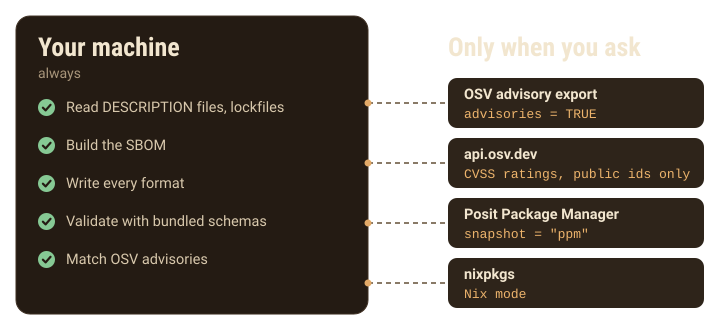

```{=html}
<style>
.sb-fig{display:block;margin:1.75rem auto !important;max-width:100%;height:auto;border:0 !important;padding:0 !important;background:none !important;border-radius:0 !important}
.sb-dark{display:none}
[data-bs-theme=dark] .sb-light{display:none}
[data-bs-theme=dark] .sb-dark{display:block}
</style>
```

Most R code that ends up in front of an auditor is not a package. It is an
analysis, a report or a Shiny app, and what it depends on is written down, if
at all, in an `{renv}` lockfile, a Posit Connect manifest, a Nix file or nowhere
but the code. This guide shows what `{sbom}` makes of each, using the small
examples that come with it. `sbom_example()` lists them and returns their
paths.

```{r}
library(sbom)
ts <- as.POSIXct("2026-01-01", tz = "UTC")
sbom_example()
```

## Start from a project folder

The `analysis` example is a script and an `{renv}` lockfile. The script uses
three packages; the lockfile pins only two.
`copy = TRUE` copies the example into a temporary folder, so that this guide
can add a file to it later.

```{r}
proj <- sbom_example("analysis", copy = TRUE)
list.files(proj)
writeLines(readLines(file.path(proj, "analysis.R")))
```

`sbom()` looks at what the folder holds and builds the SBOM from the strongest
source it finds: `renv.lock`, then a Posit Connect `manifest.json`, then a
`default.nix`, then a package `DESCRIPTION`, and last a scan of the R code.
`{sbom}` reads every other source in the folder to cross-check the first, and
records an issue for each disagreement.

{.sb-fig .sb-light fig-alt="Five sources, strongest first: renv.lock, manifest.json, default.nix, DESCRIPTION and the R code, as bars of decreasing length. In the analysis example, renv.lock builds the SBOM, manifest.json and the code cross-check it, and default.nix and DESCRIPTION are not in the folder."}
{.sb-fig .sb-dark fig-alt="" aria-hidden="true"}

```{r}
x <- sbom(proj, system = FALSE, timestamp = ts)
sbom_tree(x)
knitr::kable(sbom_issues(x)[, c("severity", "code", "message")])
```

The code scan found `{xml2}`, which the lockfile does not pin. The SBOM lists
only what `renv.lock` pins, since a lockfile outranks the code, and an issue
names `{xml2}` as used in the code but missing from the lockfile. Outside
git the project has no version; inside a repository it is the current commit,
read from `.git` without running git. The metadata lists every source read:

```{r}
x$metadata$inputs$kind
```

## Read an `{renv}` lockfile

`sbom_renv()` reads a lockfile directly. Give it a `library` and it compares
what is installed there with what is locked. A library is a folder of package
folders, and `{sbom}` reads only their `DESCRIPTION` files. The `library`
example holds `{cli}` 3.6.6, while the lockfile pins 3.6.5:

```{r}
lib <- sbom_example("library")
y <- sbom_renv(file.path(proj, "renv.lock"), library = lib, system = FALSE, timestamp = ts)
knitr::kable(sbom_issues(y)[, c("code", "message")])
```

Those `drift-` issues are the ones `summary()` gathers under "Drift". The
SBOM keeps the locked versions, and each `drift-` issue names a package whose
installed version differs from the lockfile, or that is not installed.

## Read a Posit Connect manifest

`rsconnect::writeManifest()` leaves a `manifest.json` that pins the packages
of deployed content. `sbom_rsconnect()` reads it, and lists each deployed file
as a component with the MD5 checksum the manifest records. Here the analysis
gets the manifest of its deployment, which pins a newer `{cli}`:

```{r}
invisible(file.copy(sbom_example("analysis-manifest.json"), file.path(proj, "manifest.json")))
m <- sbom_rsconnect(file.path(proj, "manifest.json"), system = FALSE, timestamp = ts)
sbom_tree(m)
```

With both files in one folder, `sbom()` still builds from the lockfile and now
records an issue for each package whose version differs between the
deployment and the lockfile:

```{r}
x <- sbom(proj, system = FALSE, timestamp = ts)
sbom_issues(x)$message[startsWith(sbom_issues(x)$code, "drift-")]
```

## Describe a Shiny app

A Shiny app is described as an application, with the R packages it needs and
the JavaScript and CSS it ships in its static folder. `sbom()` recognizes
`{rhino}`, `{golem}`, `app.R` and `ui.R` with `server.R` layouts and hands them to
`sbom_shiny()`, which you can also call yourself.

```{r}
app <- sbom_example("shiny-app")
list.files(app, recursive = TRUE)
writeLines(readLines(file.path(app, "app.R")))
s <- sbom_shiny(app, lib = character(), system = FALSE, timestamp = ts)
sbom_tree(s)
```

jQuery was recognized by its file name and dated by its header comment. A
file that matches none of `{sbom}`'s rules is left out of the SBOM. `lib = character()` hands
the code scan an empty library, so this page does not depend on whether you
have `{shiny}` installed: it shows up with an unknown version and an issue. Leave
`lib` alone in real use.

By default no app code runs. `evaluate_ui = TRUE` runs it (the whole of
`app.R`, or `ui.R`) in a separate R process, stopped after 60 seconds, to find
the HTML dependencies the UI holds. It needs `{htmltools}`, and misses anything
that `renderUI()` or other server code adds later.

```{r}
#| eval: false
sbom_shiny(app, evaluate_ui = TRUE)
```

## Read a Nix file written by `{rix}`

`sbom_nix()` reads a `default.nix` written by the `{rix}` package. Without Nix, or
with `nix = FALSE`, it reads the file as text and runs nothing:

```{r}
nixproj <- sbom_example("nix-project")
writeLines(readLines(file.path(nixproj, "default.nix")))
n <- sbom_nix(file.path(nixproj, "default.nix"), nix = FALSE, system = FALSE, timestamp = ts)
sbom_tree(n)
```

The file names packages but not their versions; those live in the nixpkgs
snapshot it pins, and an issue records that they are missing. `snapshot` looks
them up in a CRAN `PACKAGES` file: a local path, a URL, or `"ppm"` for the
Posit Package Manager snapshot of the pinned date. A local file needs no
network, and the examples include one for this `default.nix`:

```{r}
packages <- sbom_example("PACKAGES")
writeLines(readLines(packages))
n <- sbom_nix(file.path(nixproj, "default.nix"), nix = FALSE, system = FALSE,
  timestamp = ts, snapshot = packages)
sbom_tree(n)
```

```{r}
#| eval: false
# Downloads the CRAN snapshot for 2024-10-01 from Posit Package Manager.
sbom_nix("default.nix", nix = FALSE, snapshot = "ppm")
```

With Nix installed, `sbom_nix()` reads the built environment from the Nix
store instead, with real versions and the system libraries. **Nix mode is
experimental**: it is built on the output formats documented for Nix 2.18 and
later, and tested against recorded output rather than a Nix installation. It
runs `nix-instantiate`, which may download nixpkgs. Build the environment with
`nix-shell` or `nix-build` first, or `{sbom}` falls back to reading the file as
text and adds the issue `nix-not-built`.

## Describe a whole library

`sbom_installed()` describes the packages in a library, or a chosen few and
their dependencies. On the example library from earlier:

```{r}
sbom_tree(sbom_installed(lib = lib, system = FALSE, timestamp = ts))
```

R appears as `R (>= 3.4)` because `{sbom}` cannot tell which R a library other
than the current search path serves. It records the highest minimum the
packages state, with `version_is` set to `"minimum"` in `sbom_components()`.
With no arguments, `sbom_installed()` lists every package in `.libPaths()`,
which on a machine with many packages installed runs to hundreds of
components.

## Combine projects into one SBOM

Some reviews want one document for a whole system: the analysis, the
dashboard that shows its results and the in-house package both use. Give
`sbom()` several paths and a `name` for the whole. It builds an SBOM for each
path, folders and single files alike, and puts them under one new root:

```{r}
suite <- sbom(
  c(proj, app, file.path(sbom_example("study"), "renv.lock")),
  name = "research", version = "2026.1",
  system = FALSE, timestamp = ts, lib = character()
)
sbom_tree(suite, max_depth = 2)
```

A package that two projects share is listed once, and a package locked at
two versions is listed at both. `combine_sbom()` does the same for SBOMs you
already have, including ones read with `read_sbom()`. The author,
overrides and advisories you pass apply to the combined SBOM as a whole.

## Find system libraries

Many R packages need system libraries: `{xml2}` needs libxml2, `{curl}` needs
libcurl. With `system = TRUE`, the default everywhere, `{sbom}` records two kinds
of evidence. It maps each package's `SystemRequirements` to system libraries
with `{pak}`'s rules, when `{pak}` is installed, using the rules `{pak}` has on disk with
their update turned off. And for installed packages with compiled code, it
reads which shared libraries the binary links, with `otool` on macOS or `ldd`
on Linux, and asks `dpkg` or `rpm` which system package owns each one.

```{r}
#| eval: false
z <- sbom_installed("xml2")
sbom_tree(z)
```

On the Mac this guide was written on, that lists libxml2 as declared and the
libraries the `{xml2}` binary links as observed, with an issue noting that `{xml2}`
declares libxml2 but does not link it dynamically, so it may carry its own
copy. Results like these depend on the machine, which is why the rest of
this page uses `system = FALSE`. A machine without `otool`, `ldd` or `{pak}` still
gets an SBOM, with an issue naming what was not checked.

## Control network access

Building an SBOM is offline unless you ask otherwise. The exceptions:

* `advisories = TRUE` downloads OSV's advisory data (see the
  [compliance guide](compliance.html)).
* `snapshot` in `sbom_nix()`, or in `sbom()` for a folder with a
  `default.nix`, given as `"ppm"` or a URL.
* Nix mode, where `nix-instantiate` may download nixpkgs. Pass `nix = FALSE`
  to rule it out.

Everything else runs offline, including `{pak}`'s rules, the lockfile reader
and the code scan.

{.sb-fig .sb-light fig-alt="Inside your machine, always: reading files, building the SBOM, writing every format, validating with bundled schemas and matching OSV advisories. Outside, only when you ask: OSV's advisory export with advisories = TRUE, api.osv.dev for CVSS ratings with public ids only, Posit Package Manager with snapshot = ppm, and nixpkgs in Nix mode."}
{.sb-fig .sb-dark fig-alt="" aria-hidden="true"}
