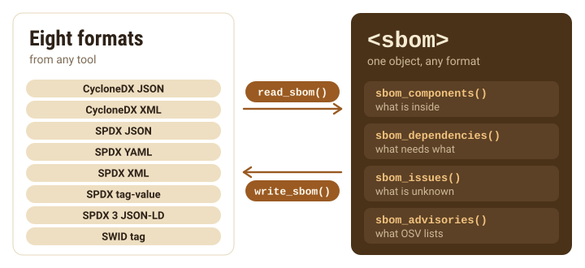
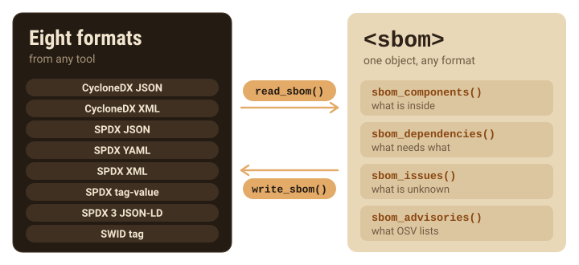
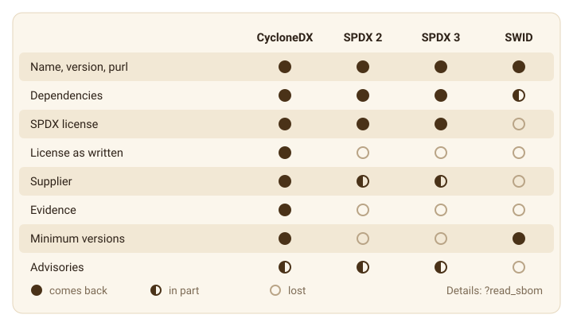
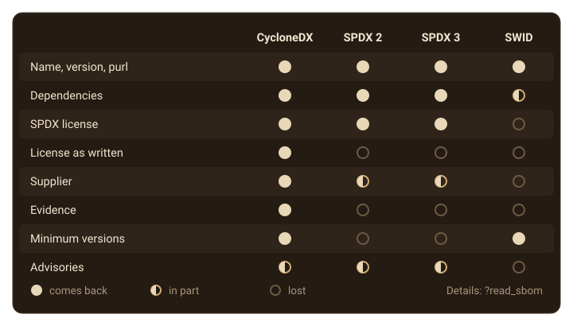
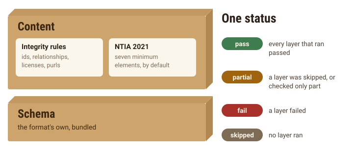
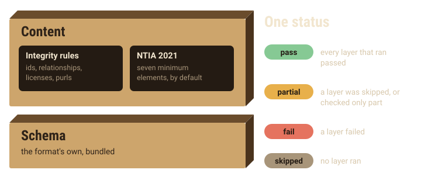
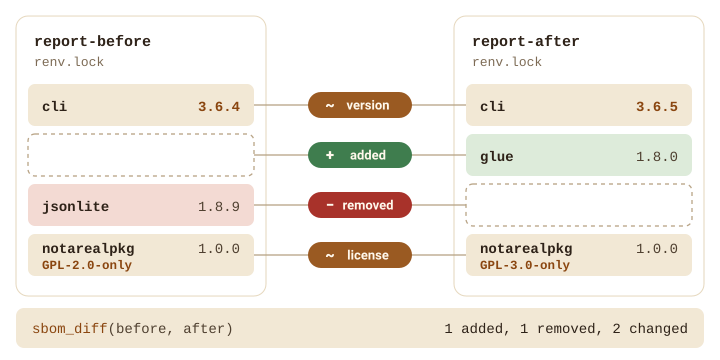
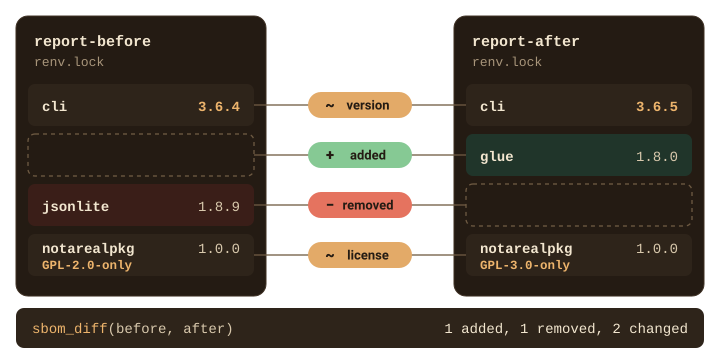

```{=html}
<style>
.sb-fig{display:block;margin:1.75rem auto !important;max-width:100%;height:auto;border:0 !important;padding:0 !important;background:none !important;border-radius:0 !important}
.sb-dark{display:none}
[data-bs-theme=dark] .sb-light{display:none}
[data-bs-theme=dark] .sb-dark{display:block}
</style>
```

Writing an SBOM is half the job. The other half arrives in your inbox: a
vendor's SBOM to review, a colleague's build to compare with yours, or your
own file that a customer's portal has just rejected. `{sbom}` reads all eight
formats it writes, from any tool, and checks them without the network.

{.sb-fig .sb-light fig-alt="read_sbom() reads any of eight formats, CycloneDX JSON and XML, SPDX JSON, YAML, XML and tag-value, SPDX 3 JSON-LD and SWID tags, into one sbom object, which sbom_components(), sbom_dependencies(), sbom_issues() and sbom_advisories() inspect, and write_sbom() writes it back out in any of the formats."}
{.sb-fig .sb-dark fig-alt="" aria-hidden="true"}

```{r}
library(sbom)
ts <- as.POSIXct("2026-01-01", tz = "UTC")
x <- sbom_package(system.file("DESCRIPTION", package = "sbom"), system = FALSE, timestamp = ts)
out <- file.path(tempdir(), "formats")
write_sbom(x, out, format = "all")
```

## Read any SBOM

`read_sbom()` turns a file back into an `<sbom>`, which you can print,
summarize, compare or write again in another format. It detects the format
from the content, not the name, which helps with files called `sbom-final-v2.txt`.

```{r}
mystery <- file.path(tempdir(), "sbom-final-v2.txt")
file.copy(file.path(out, "sbom-0.1.1.spdx"), mystery)
y <- read_sbom(mystery)
y
y$metadata$notes[1]
```

Read a file and write it back in the same format, and what the file held
comes back: the same components, versions, licenses, package URLs, suppliers
and dependencies, so `sbom_diff()` finds no differences. The new file differs
from the old one only in details. `read_sbom()` adds a note naming the file it
read, so the serial number, which derives from the content, changes too.
`{sbom}` builds some ids from its own ecosystem labels, such as `local` and
`base-r`, which no format stores, so those ids change. And the `DESCRIPTION`
dependency fields that CycloneDX carries as properties are not read back.

Writing to a different format loses whatever that format has no field for.
SPDX has no field for R's `License` field as written, and a SWID tag keeps
little beyond names, versions and purls for anything but its root. The Details
of `?read_sbom` list every value each format loses.

{.sb-fig .sb-light fig-alt="What read_sbom() gets back from CycloneDX, SPDX 2, SPDX 3 and SWID. Names, versions and purls come back from all four. Dependencies from all, SWID only for the root. SPDX licenses from all but SWID. The license as written and the evidence only from CycloneDX. Suppliers from CycloneDX, in part from SPDX 2 and 3. Minimum versions from CycloneDX and SWID. Advisories in part from CycloneDX, SPDX 2 and SPDX 3."}
{.sb-fig .sb-dark fig-alt="" aria-hidden="true"}

Files from other tools read the same way. One of `{sbom}`'s examples is a small
CycloneDX file of the kind a Python tool might write:

```{r}
other <- sbom_example("dashboard.cdx.json")
writeLines(readLines(other))
d <- read_sbom(other)
sbom_tree(d)
knitr::kable(sbom_components(d)[, c("name", "version", "ecosystem", "license_spdx", "purl")])
```

When `{sbom}` cannot read part of a file, such as a relationship of a type it
does not model or two elements that share an id, it records an issue, and
`sbom_issues()` lists it as it would for an SBOM `{sbom}` built. Reading SPDX
YAML needs the `{yaml}` package.

## Validate a file

`validate_sbom()` runs two layers of checks. The schema layer checks the file
against the schema of its format and version. `{sbom}` bundles the schemas, so
this works offline:

| Format | Checked against |
|:--|:--|
| CycloneDX | the bundled schema of its format |
| SPDX 2 in JSON or YAML | the bundled schema of its format |
| SPDX 2 in XML or tag-value | converted to the SPDX JSON model and checked against the JSON schema |
| SPDX 3 | its JSON schema, without its Shapes Constraint Language rules |
| SWID | structural rules or, when you supply it, the standard's official schema |

The SPDX 2.2 and 2.3 specifications publish a schema for JSON only. They
have no XML schema and no grammar for tag-value, and they describe their XML
format as still in development. So `{sbom}` converts XML and tag-value
documents to the JSON model, whose schema the specification does publish.
SPDX's own validator, tools-java (behind tools.spdx.org), also reads every
format into one model and checks it there, with a schema step for JSON only.

The JSON schemas need the `{jsonvalidate}` package; without it `{sbom}` skips
that layer and reports it as `skipped`. The content layer then checks every
document against integrity rules (unique ids, relationships that name elements
the document defines, license expressions on the SPDX License List, purls that
parse, and valid names and versions for R packages) and, under the default
profile, the minimum elements of the NTIA's 2021 report: supplier, name,
version, identifier, relationships, author and timestamp.

{.sb-fig .sb-light fig-alt="Two layers stacked like boards: the schema layer at the bottom, the format's own schema, bundled; the content layer on top, with the integrity rules and, under the default profile, the NTIA 2021 minimum elements. One status sums them up: pass, partial, fail or skipped."}
{.sb-fig .sb-dark fig-alt="" aria-hidden="true"}

Here is the Python tool's file:

```{r}
v <- validate_sbom(other)
v
```

The errors are all about completeness: no supplier anywhere, no identifier
for the application, and only a tool where a person or organization should be
named as author. `as.data.frame()` gives the findings
as a table, ready for a review log:

```{r}
knitr::kable(as.data.frame(v))
```

`profile = "none"` keeps the integrity rules and drops the NTIA checks, to
test whether a file is well formed without testing whether it is complete:

```{r}
validate_sbom(other, profile = "none")$status
```

### Check `{sbom}`'s own files

Each format gets the strongest check it can. Statuses are `pass`, `fail`,
`partial` (a layer could check only part of the rules, or was skipped) and
`skipped`.

```{r}
files <- list.files(out, full.names = TRUE)
# SPDX YAML can only be read with the yaml package.
if (!requireNamespace("yaml", quietly = TRUE)) files <- files[!endsWith(files, ".yaml")]
status <- vapply(files, function(f) validate_sbom(f, profile = "none")$status, "")
knitr::kable(data.frame(file = basename(files), status = unname(status)))
```

SPDX XML and tag-value have no official schema, SPDX 3's SHACL rules are not
checked, and SWID tags get `{sbom}`'s structural rules, so those are `partial` at
best. Without `{jsonvalidate}`, the JSON formats are `partial` too.

With the NTIA profile switched back on, `{sbom}`'s own SBOM fails:

```{r}
validate_sbom(file.path(out, "sbom-0.1.1.cdx.json"))
```

None of R, its base packages or `{sbom}` itself, read here from a local
folder, has a package URL, and R and its base packages have no supplier.
`{sbom}` does not invent either, so they stay missing until you supply them
with overrides.
The [compliance guide](compliance.html) shows how.

### Check a SWID tag

`{sbom}` does not bundle the ISO/IEC 19770-2:2015 schema of SWID tags, since ISO's
notice does not clearly allow it to be redistributed. A tag is checked against
`{sbom}`'s structural rules instead, which are no stricter than the ISO schema,
and the result marks the schema check as `partial`:

```{r}
validate_sbom(file.path(out, "sbom-0.1.1.swidtag"))
```

To check a tag fully, download the schema from
<https://standards.iso.org/iso/19770/-2/2015-current/schema.xsd> and point the
`sbom.swid_xsd` option at it. `{sbom}` accepts only that file, recognized by its
SHA-256, and needs no network for the check.

```{r}
#| eval: false
old <- options(sbom.swid_xsd = "path/to/schema.xsd")
validate_sbom("sbom-0.1.1.swidtag")
options(old)
```

A SWID tag has no field for the time it was made, so under the NTIA profile it
always fails `ntia-timestamp`. Use it alongside another format, not instead.

### Stop a script on failure

`error_on` turns findings into an R error, for continuous integration:

```{r}
res <- tryCatch(
  validate_sbom(other, error_on = "error"),
  sbom_validation_error = function(e) e
)
class(res)
nrow(as.data.frame(res$validation))
```

## Compare two SBOMs

`sbom_diff()` lists what was added or removed between two SBOMs, and what
changed version, license or source. The examples `report-before` and
`report-after` hold a project's lockfile before and after an update:

```{r}
before <- sbom_renv(file.path(sbom_example("report-before"), "renv.lock"),
  system = FALSE, timestamp = ts)
after <- sbom_renv(file.path(sbom_example("report-after"), "renv.lock"),
  system = FALSE, timestamp = ts)
sbom_diff(before, after)
```

{.sb-fig .sb-light fig-alt="The report's lockfile before and after an update, side by side. cli went from 3.6.4 to 3.6.5, a version change; glue 1.8.0 was added; jsonlite 1.8.9 was removed; notarealpkg stayed at 1.0.0 but its license went from GPL-2.0-only to GPL-3.0-only. sbom_diff() sums it up as 1 added, 1 removed, 2 changed."}
{.sb-fig .sb-dark fig-alt="" aria-hidden="true"}

`{notarealpkg}` kept its version number but changed its license, a change that
is easy to miss in release notes.
`as.data.frame()` returns the changes as a data frame.

The two SBOMs need not share a format. Each format keeps a different part of
what `{sbom}` knows (SPDX, for one, has no field for R's license as written), so
`sbom_diff()` compares only what both of them state. An SBOM and its own SPDX
copy therefore show no differences:

```{r}
spdx <- file.path(tempdir(), "after.spdx.json")
write_sbom(after, spdx)
sbom_diff(after, read_sbom(spdx))
```
