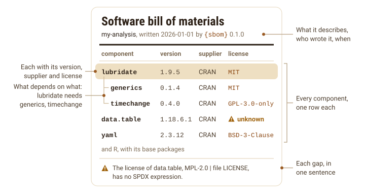
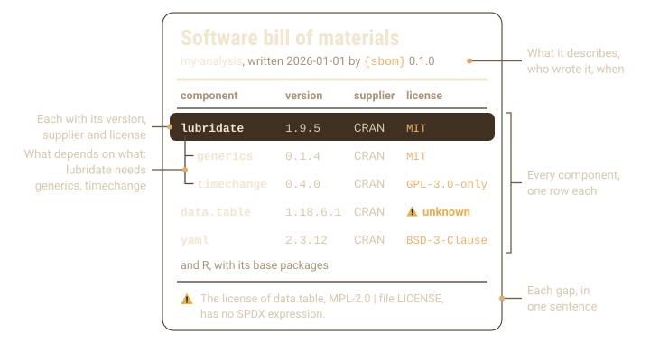
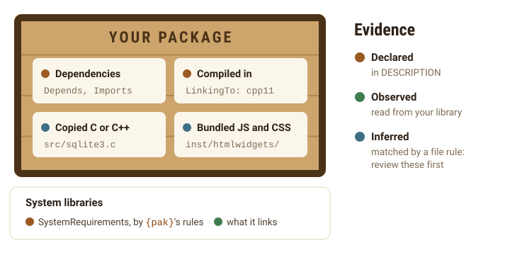
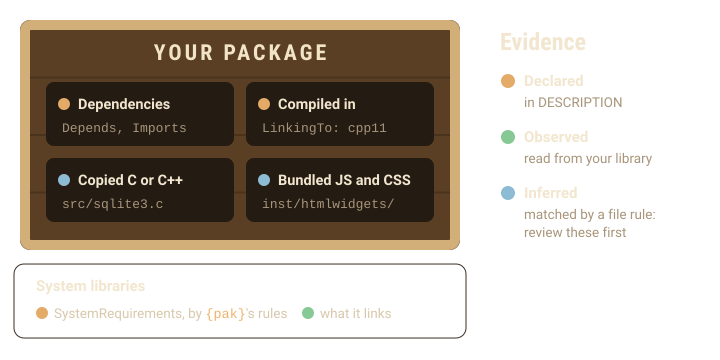
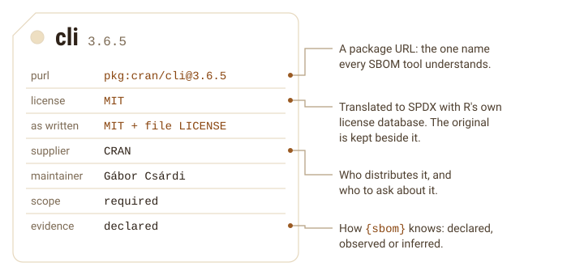
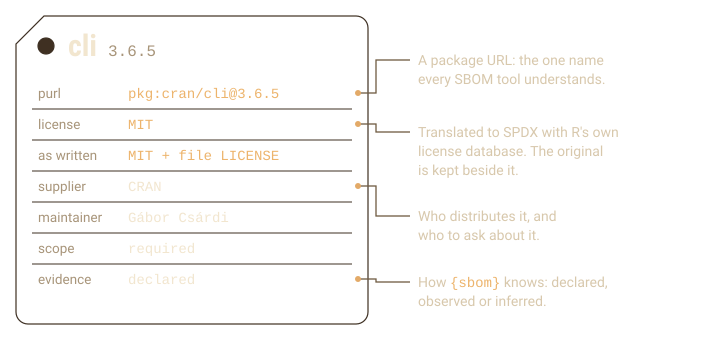

```{=html}
<style>
.sb-fig{display:block;margin:1.75rem auto !important;max-width:100%;height:auto;border:0 !important;padding:0 !important;background:none !important;border-radius:0 !important}
.sb-dark{display:none}
[data-bs-theme=dark] .sb-light{display:none}
[data-bs-theme=dark] .sb-dark{display:block}
</style>
```

A software bill of materials, or SBOM, is the ingredients label on a piece of
software: every component, its version, who supplies it, its license and what
depends on what. Security teams want one so that when the next advisory lands
they can tell in minutes, not days, whether it concerns them. Compliance teams
want one so that "what exactly did we run?" has a written answer.

{.sb-fig .sb-light fig-alt="An SBOM for a project called my-analysis, written on 2026-01-01 by sbom 0.1.0. It lists every component, one row each, with its version, supplier and license: lubridate 1.9.5, MIT; generics 0.1.4, MIT, and timechange 0.4.0, GPL-3.0-only, drawn under lubridate because lubridate needs them; data.table 1.18.6.1, license unknown; and yaml 2.3.12, BSD-3-Clause, all from CRAN. At the foot, the one gap in one sentence: the license of data.table, MPL-2.0 | file LICENSE, has no SPDX expression."}
{.sb-fig .sb-dark fig-alt="" aria-hidden="true"}

`{sbom}` writes that label for R. It reads the `DESCRIPTION` files already on
disk, along with lockfiles, deployment manifests and Nix files, and runs no
package code. It touches the network only when you ask it to. This page builds
one SBOM, looks at it from a few angles and writes it out in every format.

```{r}
library(sbom)
```

## Build one

The nearest package to hand is `{sbom}` itself. `sbom_package()` takes a package
folder, a `DESCRIPTION` file or a source tarball.

```{r}
x <- sbom_package(
  system.file("DESCRIPTION", package = "sbom"),
  system = FALSE,
  timestamp = as.POSIXct("2026-01-01", tz = "UTC")
)
x
```

Two arguments are there for this page's sake. `system = FALSE` skips the
search for system libraries, which runs `otool` or `ldd` and would make the
output depend on the machine that built the page; the
[projects guide](projects.html) explains it. `timestamp` pins the
creation time, so the document comes out the same on every build. Leave it
out and `{sbom}` uses the current time, or `SOURCE_DATE_EPOCH` when that is set.

`{sbom}` follows the `Depends`, `Imports` and `LinkingTo` fields down through
every package they reach, and lists the root's own `Suggests` without
following them further. Each dependency is looked up in your library, so the
SBOM records the versions you actually have installed. A dependency that is
not installed still gets a row, with an unknown version and an issue that
names it as not installed.

## Inspect it

`summary()` counts what is there. Evidence says how `{sbom}` knows each thing:
*declared* means a file such as a `DESCRIPTION` or a lockfile states it,
*observed* means `{sbom}` read it from what is installed, and *inferred* means
one of `{sbom}`'s rules recognized it, such as a jQuery file by its name.

{.sb-fig .sb-light fig-alt="A crate stands for a package. Inside: its dependencies and the code compiled in through LinkingTo, both declared; C or C++ copied into src/ and JavaScript or CSS bundled in inst/, both inferred because a rule matched. Under it, the system libraries it needs: declared through SystemRequirements, and observed in what the binary links."}
{.sb-fig .sb-dark fig-alt="" aria-hidden="true"}

```{r}
summary(x)
```

`sbom_tree()` draws the dependency tree. `max_depth = 1` keeps it to the
packages `{sbom}` names directly; the full tree lists a package again under
each package that needs it.

```{r}
sbom_tree(x, max_depth = 1)
```

The components themselves are a data frame, one row each, with more columns
than fit on a page: package URL (purl), supplier, maintainer, the license as
written, homepage and so on.

{.sb-fig .sb-light fig-alt="One component, cli 3.6.5: its package URL pkg:cran/cli@3.6.5, its license MIT, translated from MIT + file LICENSE as written, its supplier CRAN, its maintainer, its scope and its evidence, declared."}
{.sb-fig .sb-dark fig-alt="" aria-hidden="true"}

Here is a slice of the table.

```{r}
comps <- sbom_components(x)
knitr::kable(comps[, c("name", "version", "ecosystem", "scope", "license_spdx", "evidence")])
```

Licenses are translated from R's `License` field into SPDX expressions with
`license_spdx()`, which looks each one up in R's own license database.
Base packages show no SPDX license because they are part of R.

The relationships between them are in `sbom_dependencies()`, one row per edge:

```{r}
head(sbom_dependencies(x))
```

The issues list what `{sbom}` could not find or check:

```{r}
knitr::kable(sbom_issues(x)[, c("severity", "code", "message")])
```

Each issue is one sentence, with the `ref` of the component it concerns.
`write_sbom()` copies the sentences into the file: `sbom:note` properties in
CycloneDX, the document comment in SPDX 2. To close a gap, assert the missing
value with an override, as the [compliance guide](compliance.html) shows.

## Write it

`write_sbom()` picks the format from the file extension.

```{r}
path <- file.path(tempdir(), "sbom.cdx.json")
write_sbom(x, path)
cat(head(readLines(path), 12), sep = "\n")
```

Pass `format` and `version` when the extension is not enough, for instance
when a reviewer's tool only reads SPDX 2.2:

```{r}
write_sbom(x, file.path(tempdir(), "sbom-old.json"), format = "spdx-json", version = "2.2")
```

`format = "all"` writes every standard format into a folder, named after the
root component:

```{r}
out <- file.path(tempdir(), "sbom-all")
write_sbom(x, out, format = "all")
list.files(out)
```

`sbom_formats()` lists what is on offer, with each format's versions and the
default:

```{r}
knitr::kable(sbom_formats()[, c("format", "name", "extension", "versions", "default_version")])
```

If you were asked for "an SBOM" and nothing more, ask which format. Failing an
answer, CycloneDX JSON and SPDX JSON are the two that most tools read. The CSV
inventory is not a standard and is not part of `"all"`: it is a table for
people with spreadsheets, described in the [compliance guide](compliance.html).

## Keep going

The [projects guide](projects.html) builds SBOMs for analyses and apps rather
than packages: from a folder, an `{renv}` lockfile, a Posit Connect manifest, a
Shiny app, a Nix file written by `{rix}` or a whole library, and combines
several of them into one SBOM. It also covers system libraries and when the
network is used.

The [reading and validating guide](reading-and-validating.html) reads SBOMs
that `{sbom}` or any other tool wrote, checks them against their schema and the
NTIA minimum elements, and compares two of them.

The [compliance guide](compliance.html) goes from the issues `{sbom}` reports to a
document you can sign off: overrides for what `{sbom}` cannot find, reproducible
output, the CSV inventory and security advisories.
